<a href="https://koebelt.com"></a>


  
  
  
  

 


  

<a href="https://koebelt.com/work/koebelt-dash"></a>

  <a href="https://koebelt.com/work/koebelt-dash"></a>
  
  
  

<a href="https://koebelt.com/work/cbienla"></a>
<a href="https://koebelt.com/work/facix"></a>
<a href="https://koebelt.com/work/quadcopter"></a>
<a href="https://koebelt.com/work/robotic-arm"></a>
<a href="https://koebelt.com/work/drone-controller"></a>
<a href="https://koebelt.com/work/portfolio"></a>

  


  


  


 

  
  
  
  

